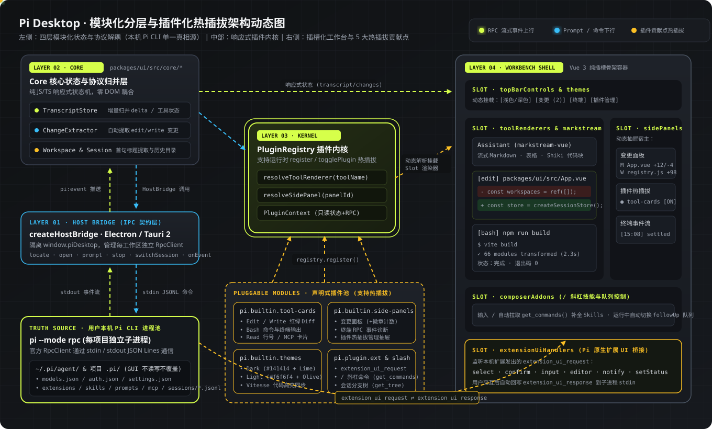
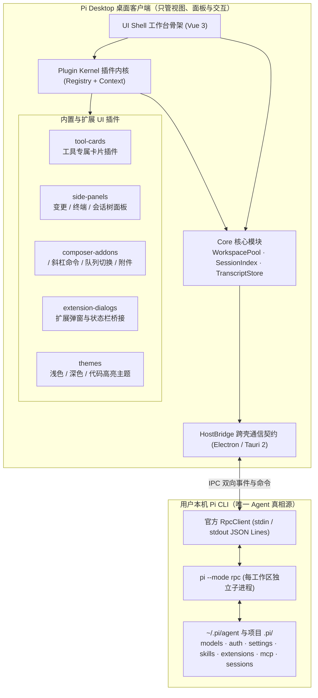
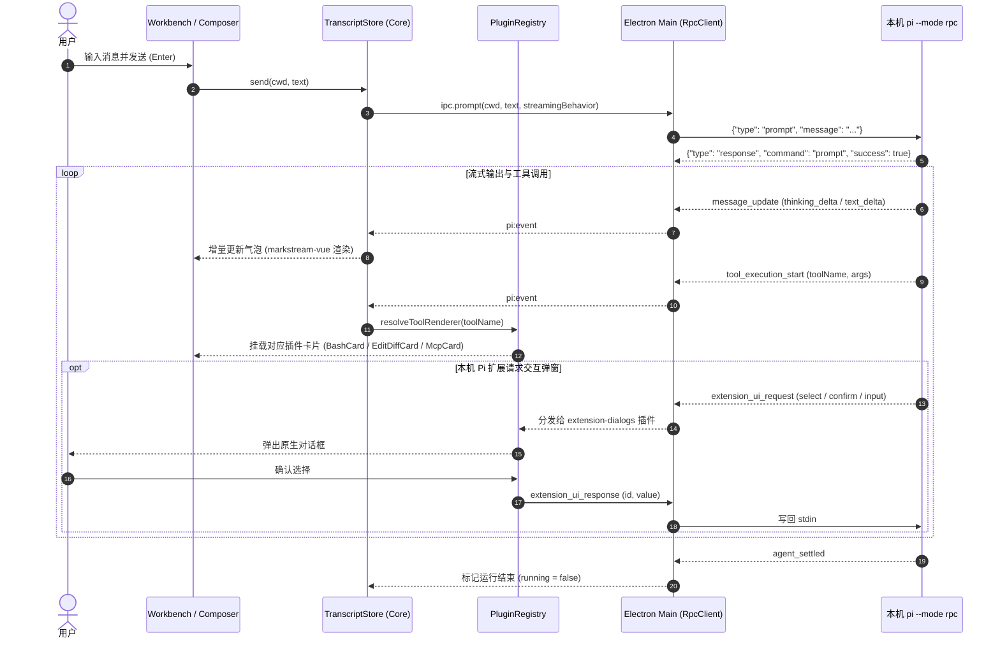

# Pi Desktop 模块化与插件化架构规划

> 本文件提供架构全景图、插件贡献点（Contribution Points）流转图、工作台插槽图以及分阶段落地路线。  
> - **SVG 动态架构全景图**：[`docs/pi-desktop-architecture.svg`](./docs/pi-desktop-architecture.svg)  
> - **动态可交互沙盘页面**：[`docs/architecture-plan.html`](./docs/architecture-plan.html)



---

## 1. 双层扩展边界（核心原则）

Pi CLI 本身已具备完整的 Agent 扩展能力（Tools / Skills / Prompts / Extensions / MCP）。Pi Desktop 的插件体系**只负责桌面端视图与交互扩展**，严格遵循“单一真相源”原则：



---

## 2. Monorepo 四层模块化结构

```mermaid
graph LR
    subgraph Layer1["1. 宿主层 (apps/*)"]
        E["apps/electron\nElectron 主进程 + Preload"]
        T["apps/tauri\nTauri 2 壳 (规划)"]
    end

    subgraph Layer2["2. 核心业务层 (packages/core)"]
        L["pi-locator\n本机 CLI 探测"]
        W["workspace-pool\n多目录 RPC 进程池"]
        S["session-index\n会话列表与首句标题"]
        M["transcript-store\n流式增量归并状态机"]
    end

    subgraph Layer3["3. 插件内核层 (packages/plugin-sdk)"]
        R["PluginRegistry\n贡献点注册与按需激活"]
        C["PluginContext\n受控状态与只读 RPC 句柄"]
    end

    subgraph Layer4["4. 视图与插件层 (packages/ui + plugins)"]
        U["Workbench Shell\n插槽化主界面容器"]
        PL["Built-in Plugins\n卡片 / 面板 / 主题 / 弹窗"]
    end

    Layer4 --> Layer3
    Layer3 --> Layer2
    Layer2 --> Layer1
```



---

## 3. 工作台插槽分布图（Workbench Slot Map）

```text
+--------------------+-----------------------------------------------------------------------+
| Pi Desktop  v1.2.0 | TopBar: [工作区标题]      [状态] [模型选择] [思考等级] [Slot:sidePanels] |
+--------------------+----------------------+--------------------------------+---------------+
| Slot:workspaces    | Slot:sessions        | TranscriptStage                | Slot:         |
|                    |                      |                                | sidePanels    |
| ● pi-desktop       | ● 为我生成一份求职... | [User Bubble]                  |               |
|   空闲             |   空闲 · 10:42       |                                | ┌───────────┐ |
| ● chat             | ● 如何在Java中自定... | [Thinking Card (默认折叠)]      | │ 变更面板   │ |
|   空闲             |   空闲 · 14:39       |                                | │ 终端日志   │ |
|                    |                      | [Slot:toolRenderers]           | │ 会话分支树 │ |
|                    |                      |   ├─ bash 终端卡片插件          | └───────────┘ |
|                    |                      |   ├─ edit Diff 卡片插件         |               |
|                    |                      |   └─ mcp__* 结构化卡片插件      |               |
|                    |                      |                                |               |
|                    |                      | [Assistant (markstream-vue)]   |               |
|                    |                      +--------------------------------+               |
|                    |                      | Slot:extensionWidgets          |               |
|                    |                      +--------------------------------+               |
|                    |                      | Composer + [Slot:composerAddon]|               |
| [打开目录]          | [新建会话]            | (/ 命令补全 · 队列管理 · 停止)   |               |
+--------------------+----------------------+--------------------------------+---------------+
| StatusBar: [Slot:extensionStatus (本机扩展状态栏)]                         [Slot:themes 切换] |
+--------------------------------------------------------------------------------------------+
  + 全局模态层 [Slot:extensionDialogs]：响应 select / confirm / input / editor 请求
```

---

## 4. 消息与插件事件流转时序



---

## 5. 五大插件贡献点清单

| 贡献点标识 | 挂载位置 | 典型内置插件 | 核心能力说明 |
| :--- | :--- | :--- | :--- |
| `toolRenderers` | 消息流工具卡片区 | `bash-card`、`edit-diff-card`、`read-card`、`mcp-card` | 根据 `toolName` 匹配专属折叠摘要与展开详情组件 |
| `sidePanels` | 顶栏按钮 + 右侧抽屉 | `panel-changes`、`panel-terminal`、`panel-session-tree` | 动态注册右侧工具面板与顶栏开关徽章 |
| `composerAddons` | 输入框上方工具条 | `slash-commands`、`queue-manager`、`image-attachment` | 调用 `get_commands` 补全技能与 `/` 命令、管理 `followUp`/`steer` |
| `extensionUiHandlers` | 全局模态框 / 状态栏 / Widget | `extension-dialogs`、`extension-statusbar` | 完整实现 `rpc-extension-ui.md` 协议 |
| `themes` | 根节点 CSS 变量 + 代码块 | `theme-dark`、`theme-light` | 统一驱动界面 CSS 变量与 `markstream-vue` 的 Shiki 主题 |

---

## 6. 四阶段重构与落地路线

- **Phase 1：Core 与 HostBridge 抽离（模块化地基）**
  - 从 `App.vue` 抽离 `core/transcript-store.js` 与 `core/host-bridge.js`。
  - 保持现有全部功能可用，消除 `App.vue` 中的协议拼接细节。
- **Phase 2：PluginRegistry 与面板/主题插件化**
  - 建立 `plugins/registry.js`，将“变更面板”、“终端面板”、“深浅色主题”迁移为首批标准插件。
- **Phase 3：工具调用卡片插件化（视觉体验升级）**
  - 实现 `bash`（命令+退出状态+终端输出）、`edit`/`write`（文件路径+变更对比）、`read`（文件预览）、`mcp__*`（服务名+参数表）四类专属卡片插件。
- **Phase 4：Pi 原生扩展 UI 桥接与斜杠命令**
  - 落地 `extension-dialogs` 插件（支持 `select` / `confirm` / `input`）与 `slash-commands` 插件（支持 `/` 唤起本机 Skills 与命令）。
